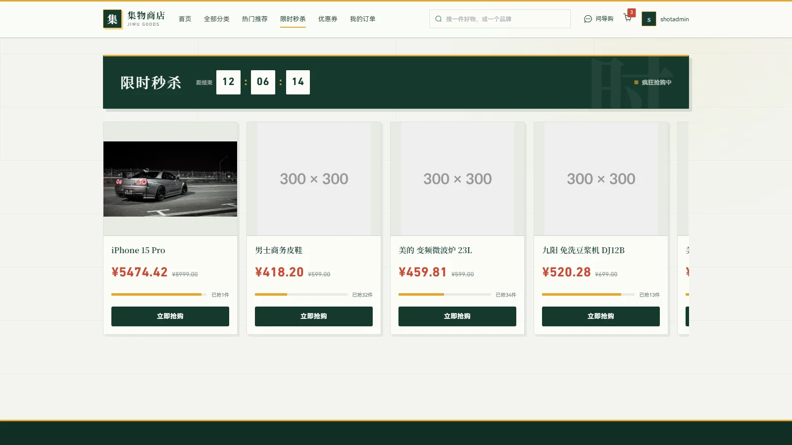
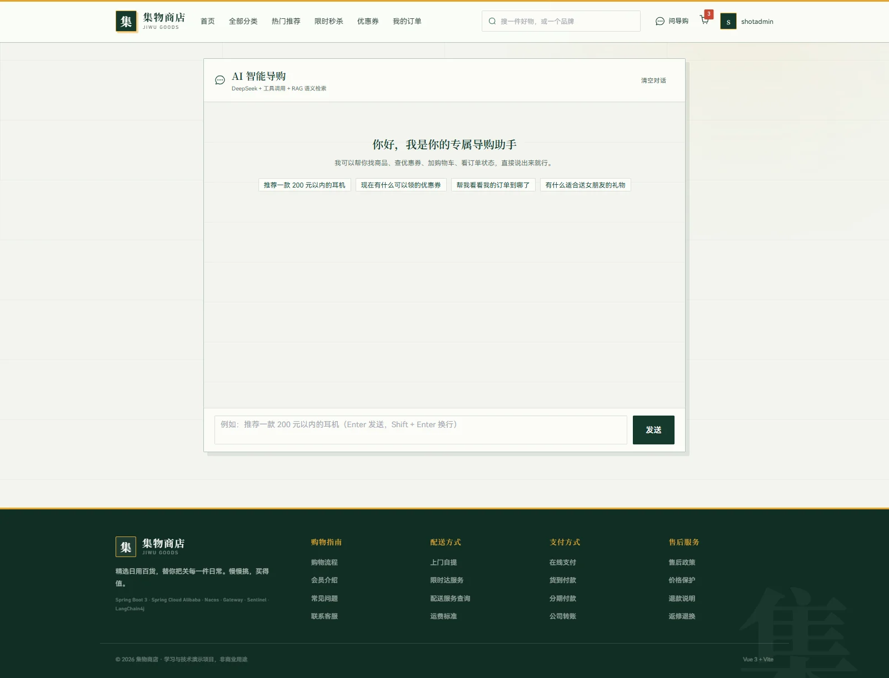
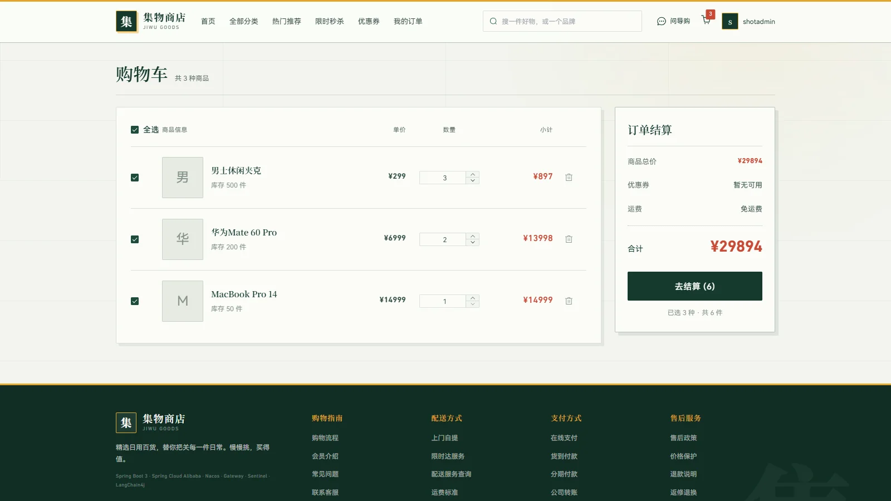
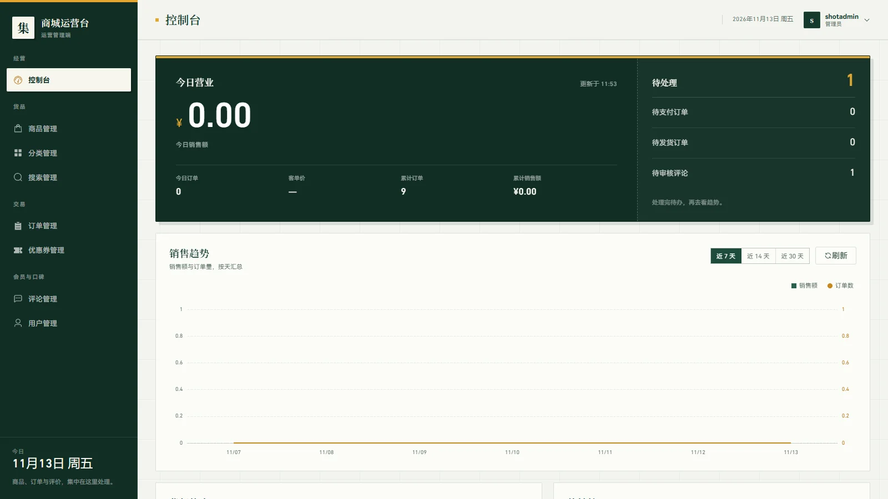
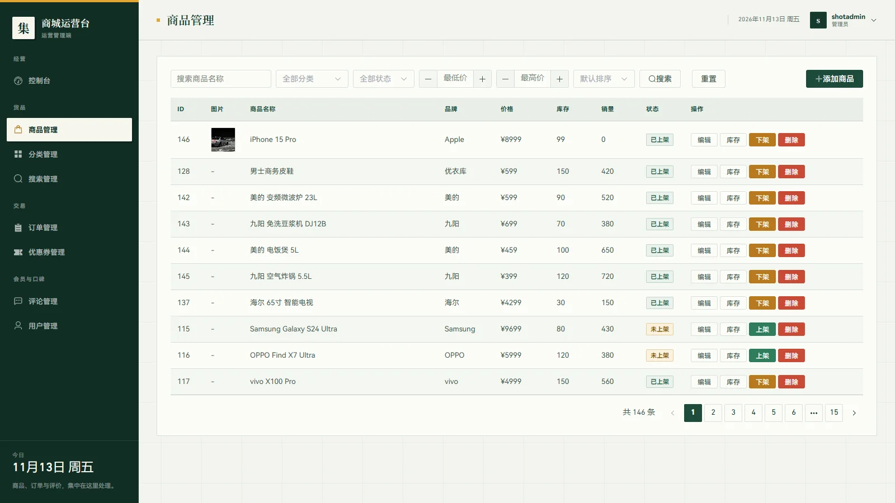
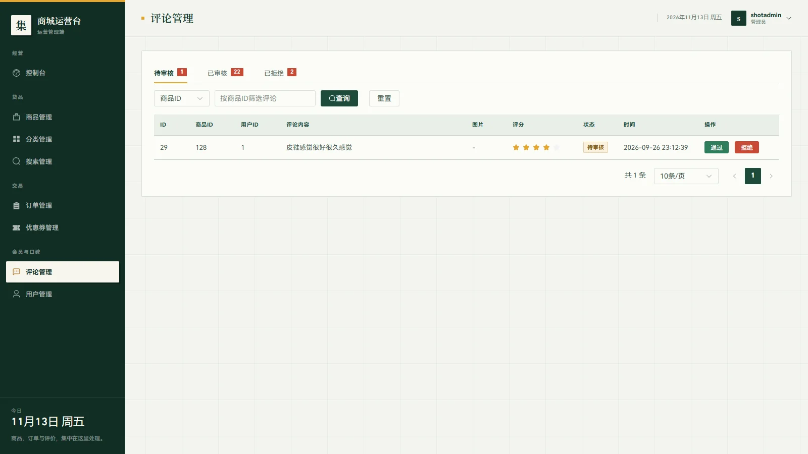
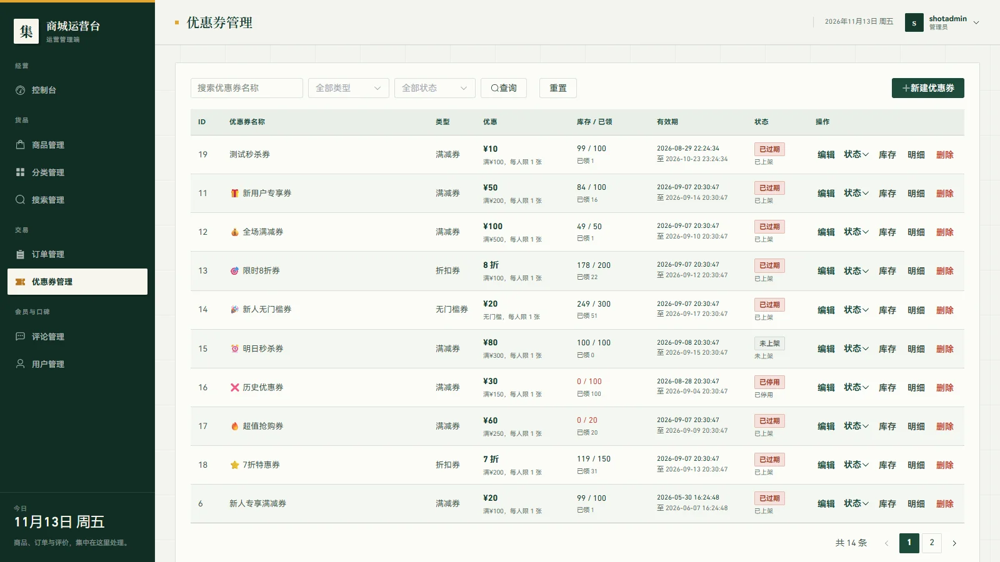
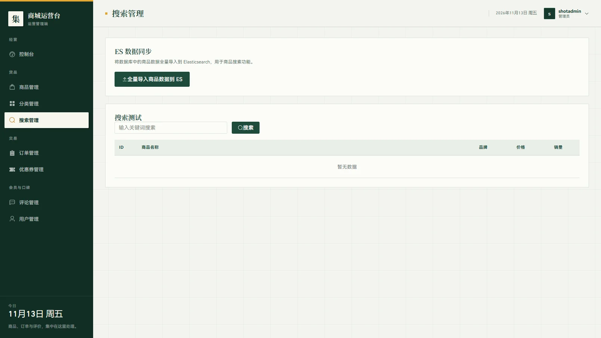

# Mall-Cloud

基于 Spring Cloud Alibaba 的分布式商城，11 个业务微服务加 1 个 AI 导购服务，覆盖商品、订单、支付、秒杀、搜索、优惠券与评论。

> 个人项目，非生产系统。支付对接支付宝沙箱，不涉及真实资金。文中所有性能数字都能在 `perf-test/` 与 `mall-ai-agent/README.md` 里找到脚本和原始输出，可自行复跑。

## 界面预览

### C 端商城

| 首页 | 限时秒杀 |
|---|---|
|  |  |

| AI 智能导购 | 购物车与结算 |
|---|---|
|  |  |

### B 端管理后台

| 数据控制台 | 商品管理 |
|---|---|
|  |  |

| 评论管理 | 优惠券管理 |
|---|---|
|  |  |

| 搜索管理与 ES 全量同步 | |
|---|---|
|  | |

## 系统架构

```
  C 端前端 (3000)              B 端前端 (3001)
       │                            │
       │ /api/c/**                  │ /api/admin/**
       ▼                            ▼
  ┌──────────────────────────────────────┐
  │         mall-gateway (9000)          │
  │  路由隔离 + JWT 验签 + Role 校验      │
  │  C 端白名单 / B 端 role==1 强制校验   │
  └───────┬──────────────┬───────────────┘
          │              │
  ┌───────▼──────┐  ┌────▼───────────────┐
  │  mall-Project │  │ mall-project-admin │
  │  C 端聚合 BFF │  │  B 端聚合 BFF      │
  │    (9090)     │  │     (9091)         │
  └───────┬──────┘  └────────┬───────────┘
          │     OpenFeign    │
     ┌────┴─────┬───────┬────┴─────┐
     │          │       │          │
  ┌──▼───┐  ┌───▼───┐ ┌──▼────┐  ┌─▼──────┐
  │ user │  │product│ │ order │  │  ...   │   11 个业务微服务
  │ 8081 │  │  8083 │  │ 8085  │  │        │   （Nacos 注册发现）
  └──────┘  └───────┘  └───────┘  └────────┘
```

- **网关（9000）**：`/api/c/**` 与 `/api/admin/**` 流量隔离；JWT 验签后下发 `X-User-Id` / `X-Username` / `X-Role`，B 端强制 `role == 1`，否则 403。
- **BFF（9090 / 9091）**：C 端与 B 端各自聚合，通过 Feign 转发，不直接访问数据库。
- **业务服务（11 个）**：独立部署、独立 schema，经 Nacos 注册发现。
- **mall-common**：统一 `Result` / `PageResult` / `JwtUtil` / `RedisService` / 全局异常处理。
- **mall-ai-agent**：独立 Python 服务，经网关接入 C 端。

## 技术栈

| 类别 | 技术 |
|---|---|
| 基础 | Spring Boot 3.3.6 / JDK 21 / Maven 多模块 |
| 微服务 | Spring Cloud 2023.0.1 + Alibaba 2023.0.1.0 / Nacos 2.x / OpenFeign |
| 网关 | Spring Cloud Gateway（C/B 流量隔离 + JWT 验签） |
| 数据 | MySQL 8 / MyBatis-Plus 3.5.5 |
| 缓存 | Redis 主从读写分离 / Redisson / Caffeine + Redis 两级缓存（优惠券） |
| 消息 | RabbitMQ（TTL + 死信队列 + 手动 ACK） |
| 搜索 | Elasticsearch 7.17 |
| AI | FastAPI / DeepSeek / Milvus |
| 前端 | Vue 3 / Element Plus / Pinia / Vite |
| 可观测 | SkyWalking 9.7（Java Agent 无侵入埋点） |
| 部署 | Docker Compose / Nginx / Cloudflare Tunnel |

## 核心问题与做法

### 1. 秒杀超卖

`用户限流 -> Redisson 锁 -> Lua 预减库存 -> DB 乐观锁 -> MQ 异步落单`

- **限流**：用户维度 Redis 计数，60 秒内最多 10 次。
- **预减**：Lua 脚本在 Redis 内原子完成"判库存 + 扣减 + 写购买标记"，超卖与重复提交在入口被挡住。
- **兜底**：DB 侧 `UPDATE ... WHERE stock >= n` 乐观锁写库存，防 Redis 与 DB 不一致时写出负数。
- **幂等**：messageId 在 Redis 去重；一人多单另由 `uk_user_coupon` 唯一索引保证。

> 这条链路只做过功能验证，没有并发压测，所以这里不给超卖数和 QPS。

### 2. 缓存穿透与热 Key

`ProductService.findById` 六层：参数校验 -> 空值缓存（5 分钟）-> 命中缓存 -> Redisson 互斥锁 + 双重检查 -> 查库 -> 随机 TTL（10–40 分钟）回填。

`perf-test/` 三组对照，每组 1 万请求（100 线程 × 100 循环），DB 查询取 `Com_select` 前后差值，单机单实例：

| 场景 | QPS | Avg | P99 | DB 查询次数 |
|---|---|---|---|---|
| A 缓存穿透（每次全新不存在 ID） | 457.9 | 175.9 ms | 315 ms | 9997 |
| B 空值缓存（30 个固定不存在 ID） | 711.0 | 99.1 ms | 254 ms | 37 |
| C 热缓存（存在商品，已预热） | 904.7 | 61.7 ms | 222 ms | 1 |

A → B 只改了入参与空值缓存，QPS 提升 55%，DB 查询从 9997 降到 37。C 组是同一条读路径的上限参考，不是同口径对比。

### 3. 订单超时关闭

`下单 -> TTL 交换机（x-message-ttl）-> 死信队列 -> 消费者关单`

- 生产端开启 confirm，消费端手动 ACK。
- 消费者先回查订单状态，仍是待支付才关单，避免误关已支付订单。
- 关单后异步回补库存与优惠券。

> 手动取消与延迟消息取消都会回补，存在双重回补；消费者也未按 messageId 幂等。两点均未修复。

### 4. 商品语义检索

`LLM 离线打标 -> Milvus 建索引 -> ES 关键词召回 + 向量召回 -> RRF（k=60）融合`

只靠标题匹配时，"聚会用的杯子"这类无字面重叠的查询召不回来。离线用 LLM 为 SPU 生成类目、属性、使用场景标签，查询时关键词与向量两路并行召回，再用 RRF 融合排名。

| 指标 | 朴素关键词基线 | 混合检索 |
|---|---|---|
| Top-3 召回 | 6/26 = 23.1% | 13/26 = 50.0% |

口径：33 条测试问题，其中 26 条计入 Top-3 字面命中；另有 9 条问的品类站内不存在，基线与混合检索都必然判负，上限为 17/26。详见 `mall-ai-agent/README.md`。

### 5. 商品列表页索引

`perf-test/index-bench/` 在 20 万行基准表上用 `EXPLAIN ANALYZE` 逐条对比：

| 查询 | 优化前 | 优化后 |
|---|---|---|
| 分类 + 上架，按价格倒序取 20 | 113 ms，index merge intersect 扫 18.8 万条索引项 + filesort 1 万行 | 0.088 ms，复合索引只读 20 行 |
| 深翻页 `OFFSET 100000` | 657 ms | 1.39 ms（游标分页）/ 43 ms（延迟关联） |

优化前的坏计划来自两条单列索引 `idx_category_id` 与 `idx_status` 求交集：为过滤 93% 上架商品，反而扫了 18.8 万条索引项。改成 `(is_deleted, status, category_id, price)` 才稳定走覆盖查询。

## 实测数据索引

| 内容 | 位置 |
|---|---|
| 缓存三组对照原始结果 | `perf-test/results.json` |
| 压测脚本 | `perf-test/product-detail.jmx`、`perf-test/bench.py` |
| 索引实验全过程与 EXPLAIN 原文 | `perf-test/index-bench/` |
| AI 评测脚本与样本 | `mall-ai-agent/eval/run_eval.py` |

## 已知问题

- 秒杀没有并发压测，超卖与重复单均无量化结论。
- `uk_user_coupon` 唯一索引在 `coupon_tables.sql` 里被注释掉，一人多单目前只靠 Redis key 拦。
- 手动取消与延迟消息取消都会回补库存，存在双重回补；延迟消费者未按 messageId 幂等。
- 延迟消息在本地事务提交前发出，事务回滚会留下孤儿消息。
- `idx_status` / `idx_category_id` 已被复合索引最左前缀覆盖，应在生产表删除，目前只在基准表验证过。
- 20 万行是造的基准数据，真实 `product` 表只有 146 行，该规模下索引收益无法在真实数据上观测。
- AI 评测集 26 条有效样本偏小，Top-3 衡量的是字面命中，不等于语义质量。

## 快速启动

### 环境依赖

- JDK 21+，Maven 3.8+
- MySQL 8.0+、Redis 6.0+、RabbitMQ 3.x、Nacos 2.x
- Node.js 18+（前端）
- Elasticsearch 7.17（可选）
- Python 3.11+（AI 导购，可选）

### 环境变量

所有密钥通过环境变量注入，仓库内不含明文密钥。本地开发复制 `deploy/.env.example` 后按需填写：

| 变量 | 用途 |
|---|---|
| `MYSQL_PASSWORD` | MySQL 密码 |
| `JWT_SECRET` | JWT 签名密钥（所有服务必须一致） |
| `NACOS_PASSWORD` | Nacos 鉴权密码 |
| `RABBITMQ_USER` / `RABBITMQ_PASSWORD` | RabbitMQ 账号 |
| `ALIPAY_PRIVATE_KEY` | 支付宝应用私钥（沙箱控制台获取） |
| `ALIPAY_PUBLIC_KEY` | 支付宝应用公钥 |
| `ALIPAY_ALIPAY_PUBLIC_KEY` | 支付宝公钥（回调验签） |

### 初始化数据库

依次执行 `mall-Project/sql/` 下的脚本：

```
mall_database.sql -> coupon_tables.sql -> add_wx_login.sql -> fix_seckill_log_table.sql
```

### 启动顺序

> 后置服务依赖前置服务的注册信息，不要并行拉起。

1. **基础设施**：Nacos（8848）-> Redis 主从（6379/6380/6381）-> RabbitMQ（5672）-> MySQL（3306）
2. **业务微服务**：user 8081 / category 8082 / product 8083 / cart 8084 / order 8085 / search 8087 / seckill 8088 / payment 8089 / comment 8090 / cache 8091 / coupon 8092
3. **网关**：mall-gateway（9000），等微服务全部注册后再启动
4. **聚合服务**：mall-Project（9090）、mall-project-admin（9091）
5. **AI 导购（可选）**：`cd mall-ai-agent && python -m uvicorn app.main:app --port 8095`
6. **前端**：

```bash
cd mall-Project/mall-frontend && npm install && npm run dev   # http://localhost:3000
cd mall-admin-frontend && npm install && npm run dev          # http://localhost:3001
```

### 访问入口

| 入口 | 地址 |
|---|---|
| C 端前台 | http://localhost:3000 |
| B 端后台 | http://localhost:3001 |
| C 端 API 文档 | http://localhost:9090/doc.html |
| B 端 API 文档 | http://localhost:9091/doc.html |
| Nacos 控制台 | http://localhost:8848/nacos |
| RabbitMQ 管理 | http://localhost:15672 |

### 服务器部署（可选）

`deploy/` 提供完整 Docker Compose 方案：MySQL / Redis / RabbitMQ / Nacos / Elasticsearch / SkyWalking 全容器化，Nginx 托管前端，Cloudflare Tunnel 免公网 IP：

```bash
cd deploy
cp .env.example .env
bash install.sh
```

### 管理员账号

在 `mall` 库的 `user` 表中把目标用户 `role` 置为 1：

```sql
UPDATE user SET role = 1 WHERE username = '你的管理员用户名';
```

## 端口一览

| 服务 | 端口 | 说明 |
|---|---|---|
| mall-gateway | 9000 | API 网关 |
| mall-Project | 9090 | C 端聚合（BFF） |
| mall-project-admin | 9091 | B 端聚合（BFF） |
| mall-user-service | 8081 | 用户 |
| mall-category-service | 8082 | 分类 |
| mall-product-service | 8083 | 商品 |
| mall-cart-service | 8084 | 购物车 |
| mall-order-service | 8085 | 订单 |
| mall-search-service | 8087 | 搜索（Elasticsearch） |
| mall-seckill-service | 8088 | 秒杀 |
| mall-payment-service | 8089 | 支付（支付宝沙箱） |
| mall-comment-service | 8090 | 评论 |
| mall-cache-service | 8091 | 缓存预热 |
| mall-coupon-service | 8092 | 优惠券 |
| mall-ai-agent | 8095 | AI 导购（FastAPI） |
| mall-frontend | 3000 | C 端前端 |
| mall-admin-frontend | 3001 | B 端前端 |
| Nacos | 8848 | 注册 / 配置中心 |
| MySQL | 3306 | 数据库 |
| Redis | 6379 / 6380 / 6381 | 主从 |
| RabbitMQ | 5672 / 15672 | 消息队列 / 管理台 |
| Sentinel Dashboard | 8080 | 流控控制台（可选） |
| SkyWalking | 8080 / 11800 / 12800 | 链路追踪（compose profile: skywalking） |
